# Q-Health: Hospital Queue Management with Random Forest

**Two queues, not one. That is why the estimates drift.**

An Android app for government clinic outpatient departments that tells each patient how long
they will actually wait. The patient journey is split into the two queues a real clinic has,
**screening** (blood pressure, BMI) and **doctor consultation**, and a separate Random Forest
Regression model predicts the waiting time for each. Staff run both queues from the same app,
every change syncs in real time through Supabase, and patients get a push notification shortly
before their turn so they do not have to sit in the waiting room.

Final Year Project, Bachelor of Electronic Engineering, Universiti Tun Hussein Onn Malaysia
(2025/2026). **Gold Medal, Final Year Project Industry Award.**

<table>
  <tr>
    <td align="center">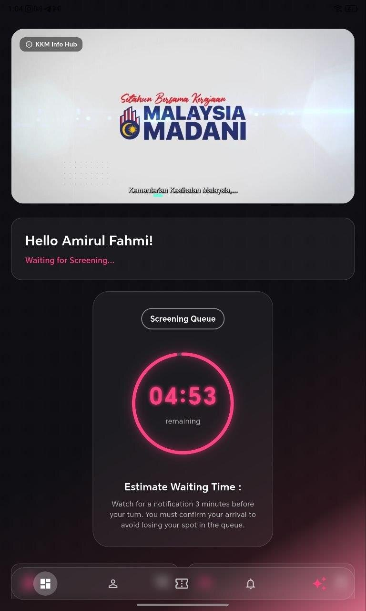</td>
    <td align="center">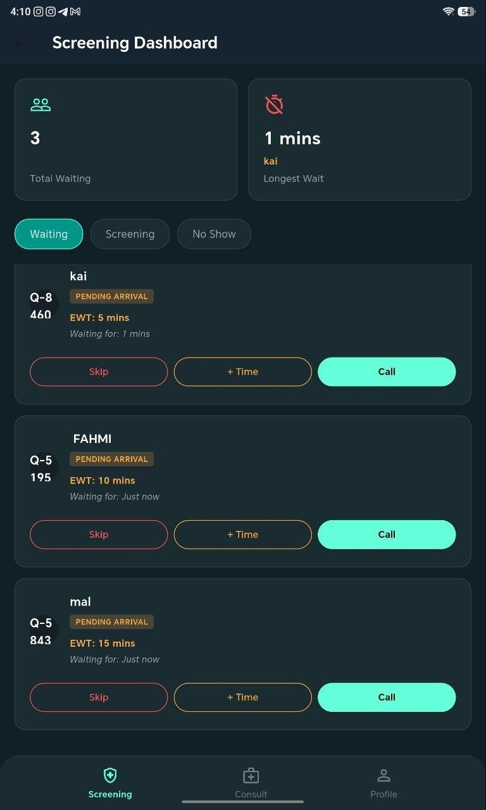</td>
    <td align="center">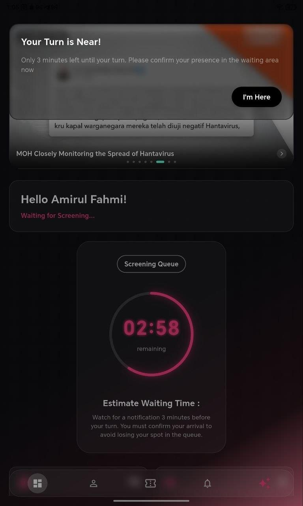</td>
  </tr>
  <tr>
    <td align="center">The patient sees their queue number and a live countdown</td>
    <td align="center">Staff see every patient, their estimate and the longest wait</td>
    <td align="center">A push notification arrives when the turn is near</td>
  </tr>
</table>

> The models are trained on a public Kaggle dataset of about 30,000 outpatient visits from
> November 2019, not on Malaysian hospital records. This is a proof of concept, not a system
> running in a real clinic.

## Why

Most clinic queue systems hand out a number such as "1001" and nothing else. Patients do not
know whether they will wait ten minutes or two hours, so they stay in a crowded waiting room
the whole time ("blind waiting anxiety"), which is also where infections spread. Government
clinics also run a two-step flow: vitals screening first, then the doctor. A single estimate
for the whole visit cannot tell a patient when each step will happen.

This project does three things that earlier systems in the literature did separately:

| | Mobile app | ML prediction | Real-time notification | Two-stage queue | Security check |
|---|:-:|:-:|:-:|:-:|:-:|
| Soman et al. (2020) | Yes | No | Yes | No | No |
| Li et al. (2021) | No | Yes | No | No | No |
| Al-Mousa et al. (2024) | No | Yes | No | Yes | No |
| **This project** | **Yes** | **Yes** | **Yes** | **Yes** | **Yes** |

The AI server lives in its own repository:
[qhealth-ai-server](https://github.com/amirulfahmiii920-beep/qhealth-ai-server) (Flask + the two
trained models).

## What it does

| Feature | How |
|---|---|
| Two-stage queue | Each ticket has a `screening_status` and a `consult_status` (Waiting, In Progress, Completed, No Show) in one Supabase table |
| Wait-time prediction | Two Random Forest models on a Flask server: one for screening, one for the doctor queue |
| Live updates | The patient dashboard and both staff dashboards read the same Supabase table, so a change by staff shows on the patient's phone without a refresh |
| Automatic hand-over | When staff mark screening as done, the patient moves to the consultation queue and gets a new estimate from the second model |
| Dynamic re-estimation | If a patient finishes early, everyone behind them gets a shorter estimate; staff can also add delay minutes to the whole queue |
| Scheduled push alerts | OneSignal `send_after` delivers "3 minutes left" at the right moment, plus an instant "It's your turn" when staff call the patient |
| Time manipulation check | Opening hours (8:00 am to 4:30 pm) are checked against Malaysia network time, not the phone clock |
| AI assistant | A Gemini chatbot that answers indoor navigation questions (pharmacy, café, convenience store) |
| Accounts | Patient sign-in with email or Google, a separate staff portal, English and Bahasa Melayu, dark mode |

## How it works

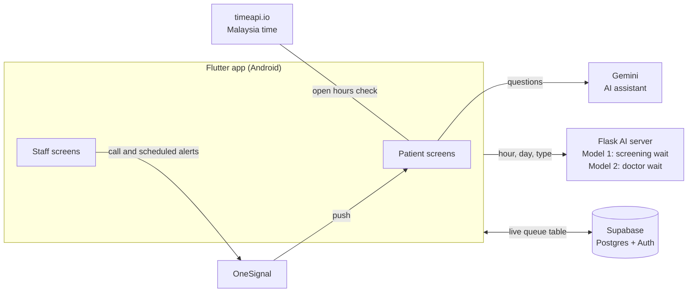

### One patient's visit

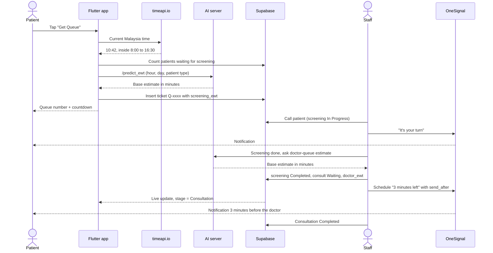

The original two-stage design from the report:

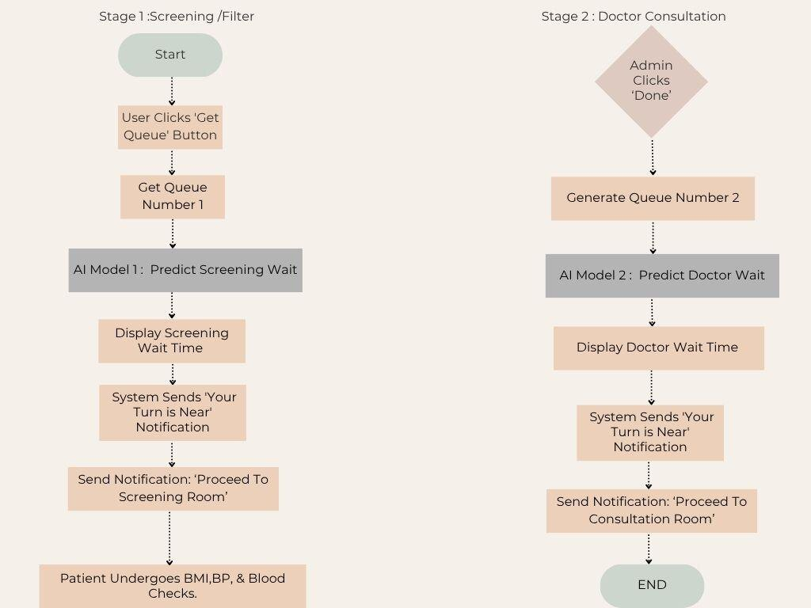

### How an estimate is built

The model gives a base estimate from the time and day. The app then combines it with the live
queue, so the estimate is never shorter than what the people ahead already need:

| Stage | Nobody ahead | People ahead | If the AI server is unreachable |
|---|---|---|---|
| Screening | 5 min | the longest current estimate + 5 min, but at least the model's estimate | 25 min base |
| Doctor | 5 min | the longest current estimate + 15 min, but at least the model's estimate | 20 min base |

When staff mark a patient as done early, the next patient's estimate drops to 5 minutes and the
time saved is taken off everyone behind them. A scheduled notification is sent 3 minutes before
the new estimate runs out:

```dart
// Notify 3 minutes before the doctor is ready
int delayConsult = (newDoctorEwt * 60) - 180;
if (delayConsult > 0) {
  sendScheduledPushNotification(patientId, "Doctor Consultation Ready",
      "Only 3 minutes left to see the doctor. Please get ready.", delayConsult);
}
```

## The two models

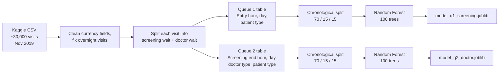

1. **Data.** 29,998 outpatient encounters after cleaning: entry, consultation and completion
   timestamps, patient type, financial class and doctor type.
2. **Two queues from one.** The dataset records one flow per visit. To match a government clinic,
   each visit's waiting time was split into a screening wait and a doctor wait (see
   [Limitations](#limitations)).
3. **Features.** Screening: `Entry_Hour`, `Entry_Day`, `Patient Type`. Doctor:
   `Screening_End_Hour`, `Screening_End_Day`, `Doctor Type`, `Patient Type`. Categorical columns
   are one-hot encoded inside a scikit-learn `Pipeline`.
4. **Chronological split.** The first 70% of visits (20,998) train the model, the next 15%
   (4,500) validate it and the last 15% (4,500) test it. A random split would let the model
   see the future; this one tests on visits that happen after the training period, like a real
   deployment.
5. **Random Forest Regression**, 100 trees, chosen over Linear Regression (cannot follow morning
   peaks) and SVMs (too slow for a real-time backend). Each tree predicts a wait and the forest
   averages them.

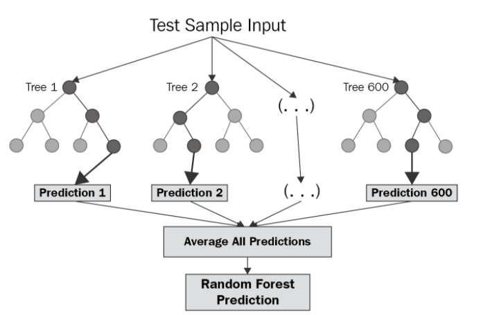

### What the models learned

| Screening queue | Doctor queue |
|---|---|
| 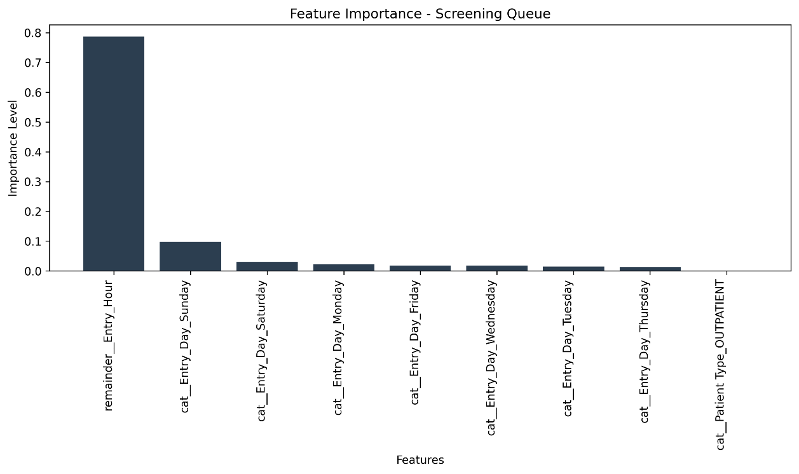 | 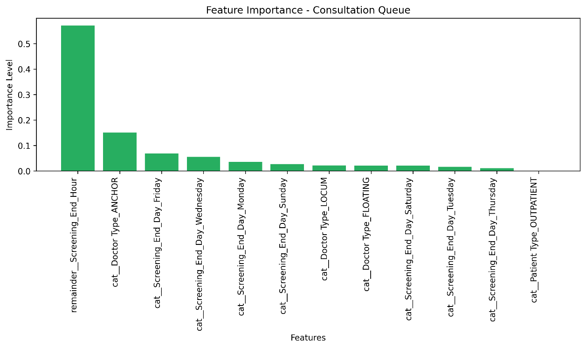 |
| The hour of arrival carries about 0.8 of the importance and the day of the week most of the rest: early-morning arrivals wait longest | The hour screening ends carries about 0.55, then the doctor type: when you finish screening and which doctor you see decide the second wait |

### Example prediction

A patient arriving at 11:00 on a Monday:

| | |
|---|---|
| 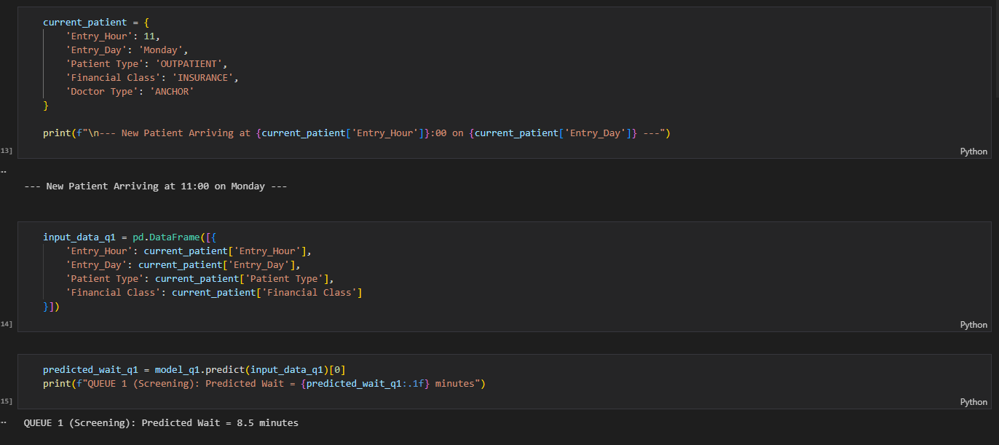 | 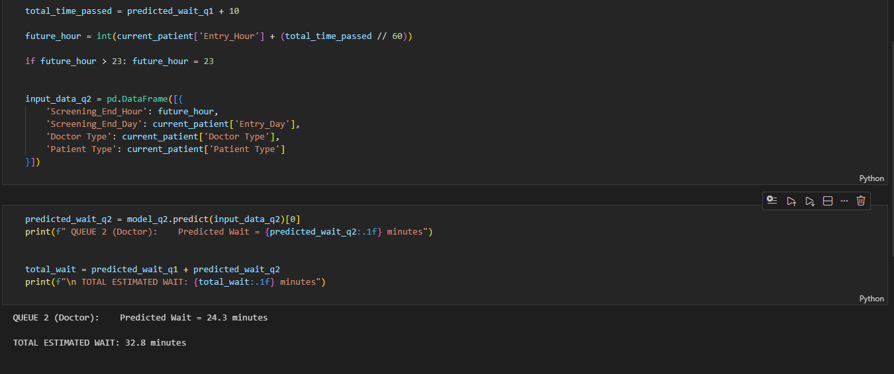 |
| Screening: **8.5 minutes** | Doctor: **24.3 minutes**, total **32.8 minutes** |

## Screenshots

<table>
  <tr>
    <td align="center">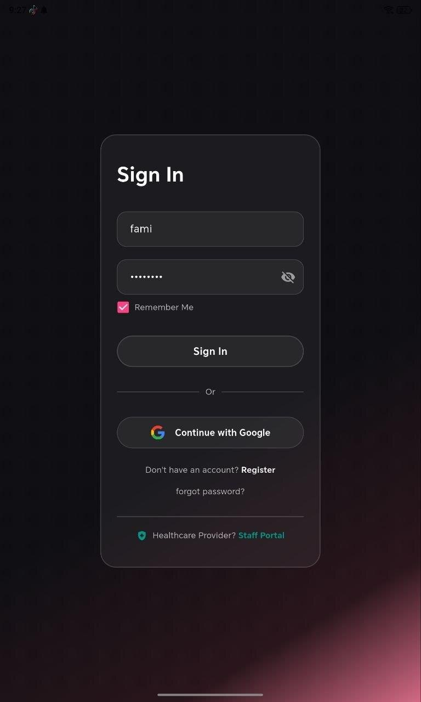</td>
    <td align="center">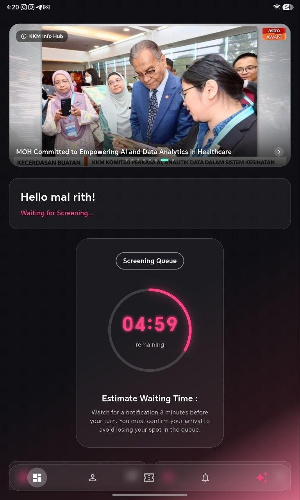</td>
    <td align="center">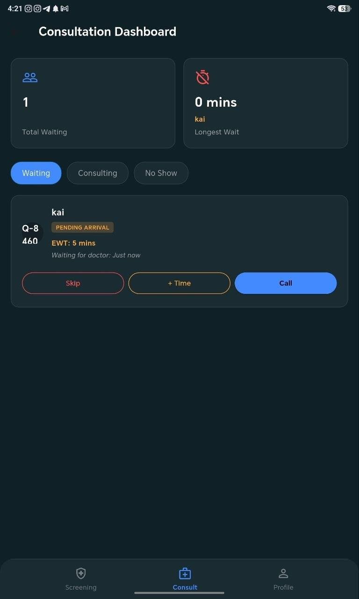</td>
    <td align="center">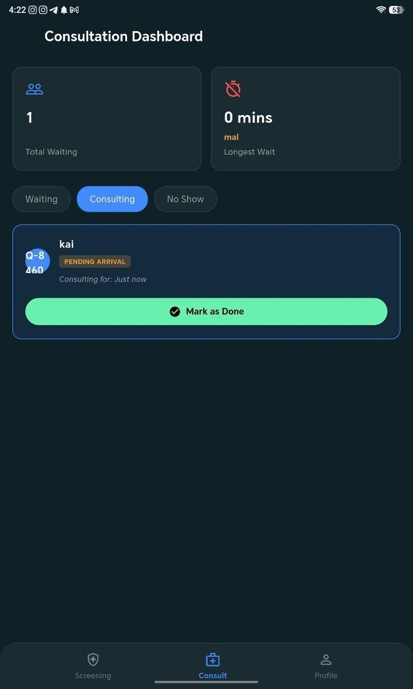</td>
    <td align="center">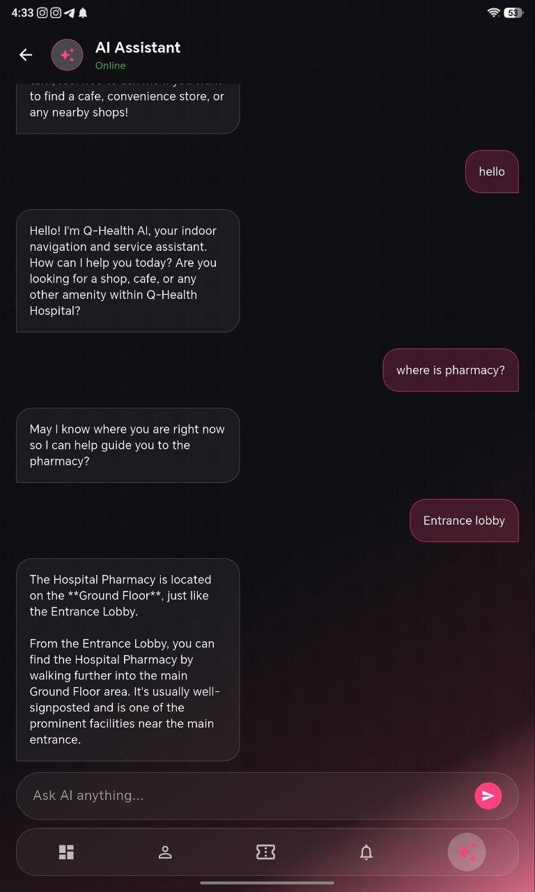</td>
  </tr>
  <tr>
    <td align="center">Sign in with email or Google; staff use a separate portal</td>
    <td align="center">The next patient's estimate after staff finished early</td>
    <td align="center">Patients move here automatically after screening</td>
    <td align="center">Staff mark the consultation as done</td>
    <td align="center">The AI assistant gives directions inside the hospital</td>
  </tr>
</table>

| | |
|---|---|
| 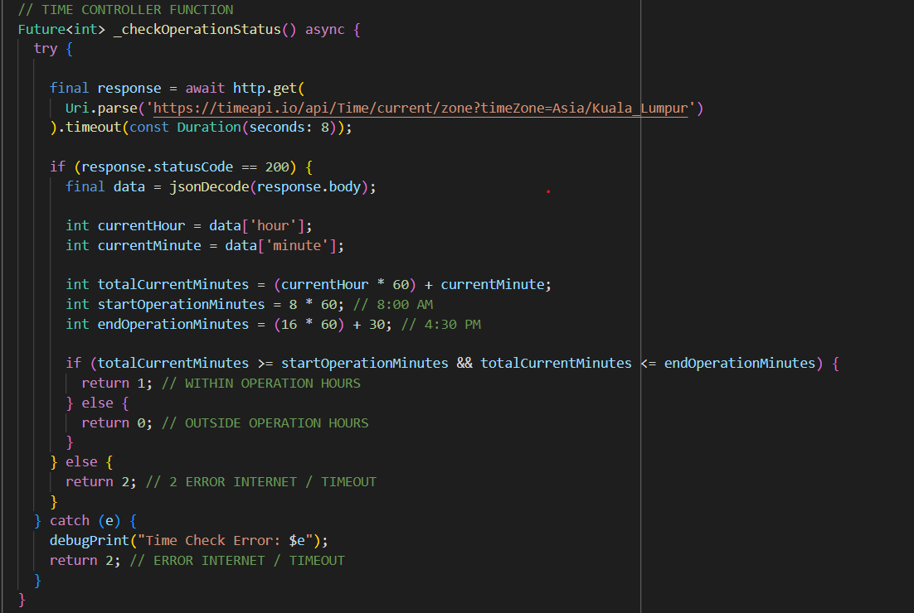 | 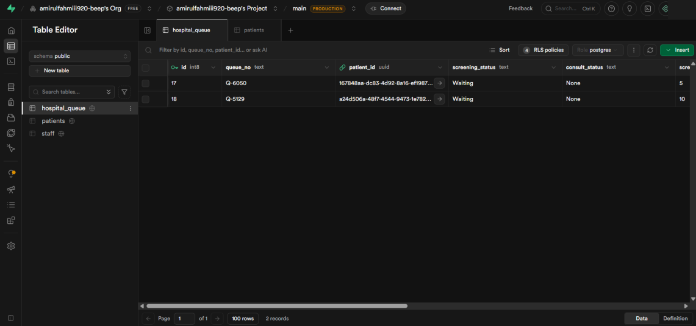 |
| Opening hours are checked against network time, so changing the phone's clock or time zone does not unlock a queue number | The `hospital_queue` table in Supabase that the app, staff screens and notifications all share |

## Testing

### Acceptance tests (from the report)

Functional user acceptance testing on the full system (app, Supabase and AI server together):

| ID | Module | Test | Expected | Result |
|---|---|---|---|---|
| UAT-01 | Patient authentication | Log in with valid credentials | Dashboard opens | Pass |
| UAT-02 | Queue dashboard | Open the app to check the queue | Live ticket number and data shown | Pass |
| UAT-03 | Time synchronisation | Change the phone time to get a number outside clinic hours | Request rejected | Pass |
| UAT-04 | Prediction engine | New registration sent through Supabase | Estimate returned without a crash | Pass* |
| UAT-05 | Push notification | Queue reaches the calling threshold | Notification appears on the phone | Pass |

\* UAT-04 only checked that the app did not crash. As the review below shows, the app falls back
to a fixed estimate when the AI server fails, so this test would pass even if no prediction came
back. A stronger test checks the server's own response, not just the screen.

The models were checked for pipeline integrity (train and predict on the held-out test set
without errors), valid output (continuous minutes within operating limits) and independence of
the two stages.

### Server and model tests (re-run October 2026)

The AI server from [qhealth-ai-server](https://github.com/amirulfahmiii920-beep/qhealth-ai-server)
was run locally (Flask test client, scikit-learn 1.9.1) and sent the exact JSON the app sends. The
saved models were also called directly with the inputs they were trained on. The first run found
three bugs in the hand-off between the app, the server and the models, all hidden by the app's
fallback estimate (which is why UAT-04 still passed). They were fixed in
[commit 14857b2](https://github.com/amirulfahmiii920-beep/qhealth-ai-server/commit/14857b2) and the
same tests were run again.

| ID | Test | Input | Expected | First run | After fix |
|---|---|---|---|---|---|
| SV-01 | Health check | `GET /` | 200 and a status line | Pass | Pass |
| SV-02 | Screening estimate, app payload | Monday 10:18, `Patient Type: 1` | 200 with minutes | Fail: 500, `columns are missing: {'Financial Class'}` | Pass: 12 min |
| SV-03 | Screening estimate on a Sunday | `Entry_Day: 0` | 200 with minutes | Fail: same error as SV-02 | Pass: 6 min |
| SV-04 | Screening estimate, empty body | `{}` | Defaults used, 200 | Fail: same error as SV-02 | Pass: 9 min |
| SV-05 | Doctor estimate, app payload | `Entry_Hour: 10.18`, queue length 3 | 200 with minutes | Fail: 500, `Patient Type` sent as `1`, model expects `OUTPATIENT` | Pass: 23 min |
| SV-06 | Doctor estimate, empty body | `{}` | Defaults used, 200 | Fail: same error as SV-05 | Pass: 8 min |
| ML-01 | Screening model, every clinic hour (8 am to 4 pm), day and financial class | 315 rows, correct inputs | Minutes, no errors | Pass: 0.0 to 38.9 min | Pass |
| ML-02 | Doctor model, every clinic hour, day and doctor type | 189 rows, correct inputs | Minutes, no errors | Pass: 0.0 to 120.9 min | Pass |
| ML-03 | Time format the app sends | 10:30 sent as `10.3`, 10:59 as `10.59` | Both treated as the 10 am hour | Fail: 10:59 got the 11 am estimate | Pass: 10:00, 10:30 and 10:59 all give 12 min |

What the fix changed in `app.py`:

1. `Patient Type` is sent to both models as `OUTPATIENT`, the label they were trained on.
2. The screening model gets the `Financial Class` column it needs. The app does not know a
   patient's financial class, so the server averages the estimate over all five classes.
3. Only the whole hour is passed to the models, so the app's `hour + minute / 100` format no
   longer pushes late-hour visits into the next hour.

The fix is on the server only, so the app works with it without a new build.

### Problems hit during development

These each left a trace in the code or the commit history:

| Problem | What went wrong | Fix |
|---|---|---|
| Wrong day on the server | The AI server on Render runs on UTC, so before 8 am Malaysia time it still read the previous day | Shift the server clock to UTC+8 before reading the day (comment "FIX ZON MASA MALAYSIA" in `app.py`) |
| Queue numbers outside clinic hours | The phone clock can be changed by the user | Read the time from a time service in `Asia/Kuala_Lumpur` instead of the phone, and refuse a number if it cannot be reached (tested as UAT-03) |
| Model input format | The models were trained on text labels, while the app sends numbers | A conversion was attempted in `app.py` ("TUKAR 'OUTPATIENT' KEPADA NOMBOR 1") but mapped the wrong way round. Found by SV-05 and fixed in October 2026 |
| Server address hard-coded | The doctor estimate URL was written into `main.dart` | Moved to `AI_SERVER_URL` in `.env` (commit of 17 Aug 2026) |
| Slow first prediction | Render's free tier puts the server to sleep, so the first request after a quiet spell is slow | A 60 second timeout on the screening call, and a fixed fallback estimate so the queue keeps working |

### Issues found in a later code review

A review of the code after submission (October 2026) found problems the acceptance tests did not
catch. The first one is fixed; the others are still open:

- **Both prediction endpoints were failing, and the app hid it** (SV-02 to SV-06, ML-03). Fixed;
  see the test table above.
- **The doctor estimate gives up after 5 seconds**, while the screening call waits 60. When the
  server is asleep, the doctor estimate always falls back to 20 minutes.
- **Passwords are stored and compared as plain text** in the `patients` table. They should move to
  Supabase Auth, which hashes them.
- **The OneSignal REST key ships inside the app.** Notifications should be sent from a server
  instead.

## Run it

Requirements: Flutter SDK, Android Studio or VS Code, and an Android emulator or phone.

```bash
git clone https://github.com/amirulfahmiii920-beep/Hospital-Queue-Management-System-Using-Random-Forest.git
cd Hospital-Queue-Management-System-Using-Random-Forest
flutter pub get
cp .env.example .env      # then fill in the values below
flutter run
flutter test              # unit tests, no phone or keys needed
```

| Variable | What it is |
|---|---|
| `SUPABASE_URL`, `SUPABASE_ANON_KEY` | Your Supabase project with the `patients`, `staff` and `hospital_queue` tables |
| `ONESIGNAL_APP_ID`, `ONESIGNAL_REST_API_KEY` | OneSignal app for push notifications |
| `GEMINI_API_KEY` | Google AI Studio key for the assistant |
| `AI_SERVER_URL` | Your deployment of [qhealth-ai-server](https://github.com/amirulfahmiii920-beep/qhealth-ai-server) |

Never commit `.env`; it is already in `.gitignore`.

## Project structure

```
lib/
  main.dart            start-up: loads .env, Supabase and OneSignal
  app.dart             MaterialApp and theme switching
  core/                language strings, theme colours, shared queue state (QueueData)
  services/
    ewt_calculator.dart       waiting-time rules for both queues (unit tested)
    ai_server_service.dart    calls to the AI server, with fallback when it is down
    clinic_hours.dart         opening hours and the network time check (unit tested)
    push_notification_service.dart   OneSignal push and scheduled reminders
  screens/
    auth/              login, register, forgot password, terms, complete profile
    patient/           home dashboard, get queue, chatbot, notifications, profile, settings
    staff/             staff login, screening and consultation dashboard, staff profile
  widgets/             shared layout, form fields and bottom navigation bars
test/                  unit tests for the EWT rules and clinic hours
assets/                images and the intro video
.env.example           the keys the app needs
docs/screenshots/      pictures used in this README

qhealth-ai-server      (separate repo)
  app.py               Flask API: /predict_ewt and /predict_consult_ewt
  model_q1_screening.joblib
  model_q2_doctor.joblib
```

## Limitations

- **The two-queue split is simulated.** The Kaggle data has one waiting time per visit. To create
  two queues, screening (5 to 12 min) and consultation (10 to 20 min) durations were drawn at
  random and the remaining wait was divided between the queues at a random 20 to 40% ratio. The
  models therefore learn the time-of-day pattern of the real data, but the exact split between
  the two queues is not measured.
- The data is from one month in 2019 and from outside Malaysia, so it does not know about local
  peaks, outbreaks or public holidays. It should be retrained on real clinic logs before use.
- The models only see time and patient or doctor type. They do not know how many doctors are on
  duty, so they cannot tell a busy day from an understaffed one.
- The features act as a proxy for crowd size; there are no sensors or cameras counting people.
- Security is at proof-of-concept level. Before handling real patient data, authentication,
  encryption and key handling would need to be hardened (for example, sending notifications from
  a server so no service keys ship inside the app).
- If the time service cannot be reached, the app refuses to issue a number rather than trust the
  phone clock.
- Android only; the iOS build is not tested.

## Next steps

1. Pilot in a real government clinic and retrain both models on live data.
2. An admin input for the number of doctors on duty, so estimates react to emergency leave.
3. Extend the assistant to clinic procedures, opening hours and registration documents (built
   separately as the [Clinic Procedure Assistant](https://github.com/amirulfahmiii920-beep/clinic-procedure-assistant)).

## Built with

Flutter (Dart), Supabase, Python, scikit-learn, Flask, OneSignal, Google Gemini, timeapi.io.
